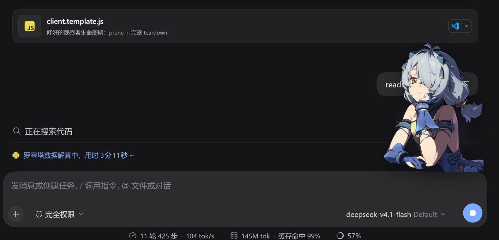
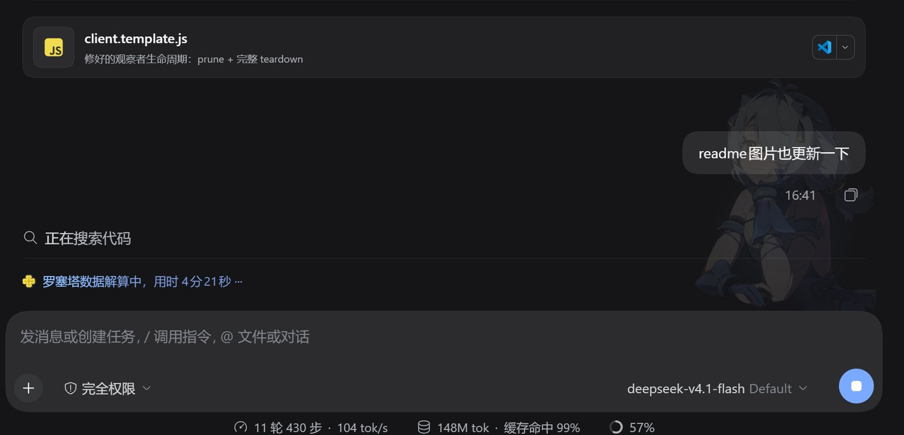
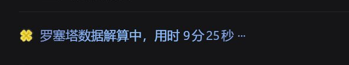

# 绝区零 · 立绘挂件

DeepSeek Harness 的 Web 界面装饰：输入框右上角站着《绝区零》的德蕾琪娜·挽昼（这套皮肤叫「柔光之影」），运行中的「罗塞塔数据解算中」前面转着一朵小黄花。三张截图都是本机实拍。

> **版权与免责声明**
>
> - 个人兴趣项目，与米哈游（miHoYo）/ HoYoverse 没有任何关联，也未获其授权或认可。
> - 《绝区零》角色形象，以及 `assets/` 下的 Spine 骨骼、图集与贴图，版权均归米哈游 / HoYoverse 所有。
> - 本仓库引用它们，仅为演示「DSH 插件如何注入并驱动一段 Spine 动画」这一技术问题，不用于任何商业用途，也不主张对它们拥有任何权利。
> - 建议你跑通后自行删除或替换这些素材；若版权方认为内容侵权，请提 issue，我会立即移除。

## 截图

立绘站在输入框右上角，循环播放待机动作：



点一下，它变透明，被盖住的对话和按钮都能看清；再点恢复：



会话跑起来时，「罗塞塔数据解算中」前面的鲸鱼尾巴换成旋转的小黄花：



## 能做什么

- **每个会话都有**：立绘挂在输入框卡片的 overlay 槽位，新建会话的空白页也能看到；悬停时轻微上浮。
- **点一下变透明**：约 12% 不透明度，用来查看被它盖住的正文、时间戳和控件。
- **运行中的小黄花**：把「深度求索中，用时 …」改写成「罗塞塔数据解算中，用时 …」，并把前面的图标换成旋转的小黄花，顺时针 3.33 秒一圈。
- **尊重减少动效**：`prefers-reduced-motion: reduce` 下立绘与小黄花都静止。
- **不白烧 CPU**：立绘按 20 Hz 待机；切到后台、滚出视口、或被点成透明后，绘制完全停止。

## 安装

仓库根目录就是插件包本身：

```bash
git clone https://github.com/a285292107s/dsh-wanzhou.git
```

在 DSH 的 profile（默认 `~/.dsh/profiles/web`）里把它接上，两种写法选一种：

**从 GitHub 装**（只想用）

```jsonc
// package.json
{
  "dependencies": {
    "@local/zzz-spine": "github:a285292107s/dsh-wanzhou"
  },
  "dsh": {
    "profile": {
      "bundles": [ /* … */, "@local/zzz-spine" ]
    }
  }
}
```

然后用 `pnpm install` 装依赖。

**本地 link**（要改代码）

把上面的依赖值换成 `"link:C:/path/to/dsh-wanzhou"` 即可，改完源码不用重新安装。

两种方式都要**重启 `dsh web`** 才生效（宿主端注册了路由，不能热更）。

如果不想动 `bundles`，也可以只加一条 loader patch：

```yaml
# ~/.dsh/profiles/web/cordis.patch.yml（不是仓库里那个同名文件）
- insert:
    - id: zzz-spine
      name: '@local/zzz-spine'
```

**卸载**：把 `bundles` 或 patch 里那一行删掉，删掉依赖，重启。

## 仓库里有什么

```
.
├── index.js              # 宿主端：把素材以同源 URL 发给页面
├── client.js             # 浏览器端产物：立绘 + 小黄花
├── client.template.js    # 上面那个的源码
├── cordis.patch.yml      # 包自带的装载声明，列进 bundles 时自动生效
├── assets/               # 立绘与花朵素材（版权见开头）
├── vendor/               # Spine 运行时及其许可证
├── scripts/              # 构建与冒烟测试
├── docs/                 # 实现说明与截图
└── locale/               # 插件描述文案
```

## 开发

没有第三方依赖，不需要 `npm install`：

```bash
npm run build   # 由 client.template.js 重新生成 client.js
npm test        # 冒烟测试：确认产物能求值、槽位注册正确
```

`client.js` 是构建产物，改了 `client.template.js` 不重建不会生效。实现细节、性能数据、素材是怎么从活动页取出来的、有哪些已知局限，都在 [`docs/DETAIL.md`](docs/DETAIL.md)。

## 许可

- **代码**：MIT，见 [`LICENSE`](LICENSE)。该许可证只覆盖代码；`assets/` 下的美术资源和 `docs/images/` 里的截图不在其内。
- **美术资源**：版权归米哈游 / HoYoverse，见开头声明。
- **Spine 运行时**：© Esoteric Software LLC，是独立的第三方作品，遵循 [`vendor/SPINE-RUNTIMES-LICENSE.txt`](vendor/SPINE-RUNTIMES-LICENSE.txt)，同样不在 MIT 范围内。

---

[](https://github.com/deepseek-ai/deepseek-harness)
